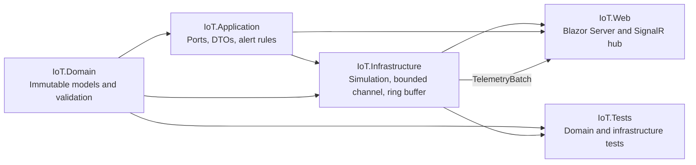

# Pulse IoT Sensor Dashboard

A responsive real-time industrial sensor dashboard built with Blazor Server, ASP.NET Core SignalR, and .NET. The solution separates domain rules, application contracts, infrastructure services, web presentation, and automated tests.

## Architecture



## Requirements

- .NET 10 SDK (or a compatible current .NET SDK)
- Windows, Linux, or macOS

## Run

From this directory:

```sh
dotnet restore IoT.sln
dotnet run --project IoT.Web
```

Open the local URL printed by ASP.NET Core. The application starts with four synthetic devices. Use the simulation selector to adjust cadence, pause or resume readings, toggle device availability, and inject a simulated boiler overheat.

## Test

```sh
dotnet test IoT.sln
```

Tests use xUnit, FluentAssertions, and bUnit. They cover bounded ring-buffer behavior, non-finite packet validation, critical/warning threshold evaluation, and rendering of a critical sensor status.

## Implementation notes

- The worker publishes batches on a bounded `Channel<T>` with drop-oldest backpressure so a slow consumer cannot grow memory without limit.
- Per-device telemetry history is held in a thread-safe fixed-capacity circular buffer.
- The simulation uses a smooth random walk with occasional spikes; its cadence can be changed at runtime.
- The strongly typed SignalR hub broadcasts telemetry groups; Blazor Server uses its circuit transport for the interactive dashboard.
- Inline SVG sparklines avoid loading a chart runtime and redraw only the small sensor card visual. The dashboard layout adapts to tablet and phone widths.
- Domain readings are checked for valid device IDs and finite values; invalid packets are discarded at repository ingress.

## Project map

- `IoT.Domain`: immutable sensor/alert records, enums, validation, result type.
- `IoT.Application`: simulator/repository/evaluator ports and telemetry contracts.
- `IoT.Infrastructure`: simulation worker, channel pipeline, repository, circular buffer.
- `IoT.Web`: interactive dashboard, reusable `SensorCard`, state container, SignalR hub.
- `IoT.Tests`: xUnit domain and infrastructure tests.
